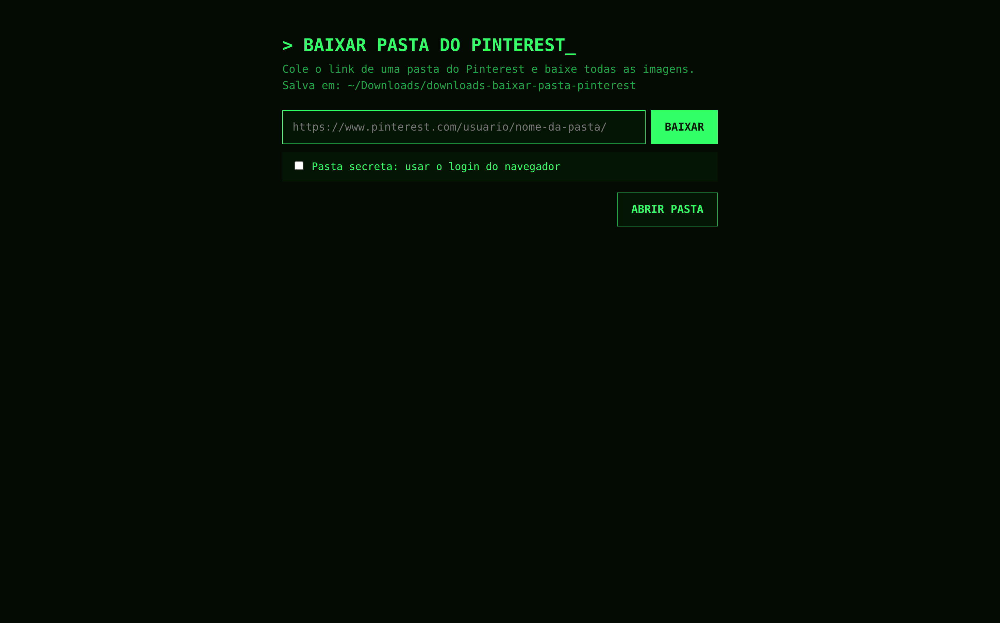

# Baixar Pasta do Pinterest

O Pinterest não deixa baixar uma pasta inteira, e os sites que fazem isso são cheios de anúncio, então fiz um que roda na sua própria máquina.

Cole o link de uma pasta e ele baixa todas as imagens (e os vídeos) dela.

## Como rodar

### Mac
- Abrir arquivo: **`Abrir Baixador.command`**

### Windows
- Abrir arquivo: **`Abrir Baixador.bat`**

Um Terminal abre, o servidor sobe e o navegador abre a página.

Se o servidor já estiver rodando, ele só abre a página.




Pronto! Agora é só aproveitar 🎉🎉🎉

## Detalhes técnicos para nerds

### Rodar pelo terminal

```bash
cd ~/Documents/Coding/baixar-pasta-pinterest
python3 server.py
```

O navegador padrão abre sozinho em http://127.0.0.1:8766. Para parar o servidor, aperte `Ctrl+C` no terminal.

A porta é a 8766 para não brigar com o Conversor do Bada (8765): os dois rodam juntos.

### Dependências

O **Abrir Baixador** instala tudo isso sozinho na primeira vez.

- Python 3 (não precisa instalar nenhuma biblioteca)
- `gallery-dl`, baixa as imagens do Pinterest

Se o gallery-dl parar de funcionar, atualize com `brew upgrade gallery-dl` (Mac) ou `python -m pip install -U gallery-dl` (Windows). O Pinterest muda com frequência.

### Baixar uma pasta

Cole o link da pasta e clique em **Baixar**. Ele roda:

```bash
gallery-dl -d ~/Downloads/downloads-baixar-pasta-pinterest "link"
```

Os arquivos ficam em:
```bash
Downloads/downloads-baixar-pasta-pinterest/pinterest/<usuário>/<pasta>
```
com o número de cada pin no nome (`pinterest_<id>.jpg`).

Baixar a mesma pasta de novo só traz o que é novo: o que já está na pasta é pulado.

Também funciona com o link de uma seção da pasta, de um pin só ou de um perfil inteiro (baixa todas as pastas).

Para mudar a pasta, edite `OUT_DIR` no `server.py`.

### Pasta secreta

Marque **Pasta secreta** e escolha o navegador em que você está logado no Pinterest. Ele roda:

```bash
gallery-dl --cookies-from-browser chrome -d ~/Downloads/downloads-baixar-pasta-pinterest "link"
```

- Mac com Chrome: na primeira vez, o Mac pede para liberar o acesso às Chaves ("Chrome Safe Storage").
- Mac com Safari: o Terminal precisa de **Acesso Total ao Disco** (Ajustes → Privacidade e Segurança).
- Windows: o Chrome novo bloqueia a leitura do login. Se der erro, use o Firefox.

### Arquivos

- `server.py`: servidor local que serve a página e executa o gallery-dl
- `index.html`: a página, com campo de link e log em tempo real
- `Abrir Baixador.command` / `Abrir Baixador.bat`: abrem tudo com dois cliques (Mac / Windows)

### Segurança

O servidor escuta só em `127.0.0.1`, então ninguém na sua rede acessa.
Ele aceita só links do Pinterest (`pinterest.com`, os domínios de cada país e `pin.it`).
